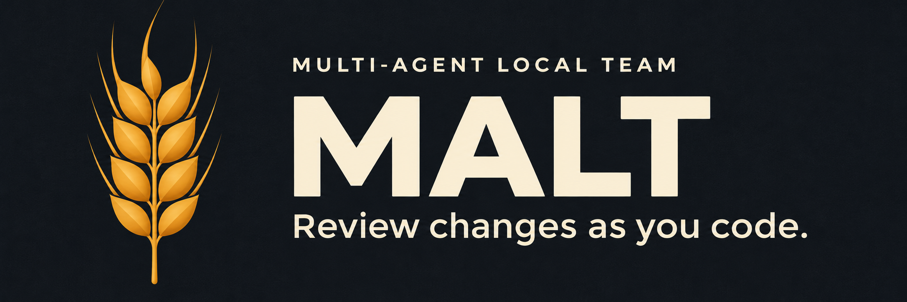

<div align="center">



# MALT

### Multi-Agent Local Team

**Focused code reviews, project standards, and clear feedback inside VS Code.**

A VS Code extension for teams who ship with AI and still care what lands in `main`.

<br />

[](https://github.com/Division4Studios/multi-agent-local-team/actions/workflows/ci.yml)
[](https://github.com/Division4Studios/multi-agent-local-team/actions/workflows/codeql.yml)
[](LICENSE)
[](https://github.com/Division4Studios/multi-agent-local-team/stargazers)
[](https://github.com/Division4Studios/multi-agent-local-team/network/members)
[](https://github.com/Division4Studios/multi-agent-local-team/issues)
[](https://github.com/Division4Studios/multi-agent-local-team/commits/main)

[](https://code.visualstudio.com/)
[](tsconfig.base.json)
[](eslint.config.mjs)
[](SECURITY.md#supply-chain-policy)
[](.nvmrc)
[](CONTRIBUTING.md)
[](CODE_OF_CONDUCT.md)

[**Why MALT**](#-why-malt) ·
[**Principles**](#-principles) ·
[**Getting started**](#-getting-started) ·
[**How we build**](#-how-we-build-malt) ·
[**Contributing**](#-contributing) ·
[**Security**](#-security)

</div>

---

> [!NOTE]
> MALT is in **early development** (preview). Star and watch the repo to follow along.

## Guides

- [First review and installation](docs/getting-started.md)
- [Settings and commands](docs/configuration.md)
- [Standards, ignored instructions, and generated output](docs/standards.md)
- [Troubleshooting and current limitations](docs/troubleshooting.md)
- [Editor acceptance checks](docs/editor-testing.md)
- [Architecture](docs/architecture.md) · [Visual design and assets](docs/design.md)

**Two file policies:** micro-reviews skip Git-ignored changes; standards discovery still reads supported instructions in ignored folders. Generated `.malt/` output is excluded from both and gets its own `.gitignore` when standards are saved.

## 💡 Why MALT

AI coding tools made it cheap to *open* pull requests and expensive to *review* them. Teams are drowning in large, plausible-looking, under-explained diffs, and reviewers become the bottleneck — or worse, the rubber stamp.

MALT is a layer that works **locally, inside VS Code**, between the code your AI tools produce and the PR your teammates have to read. Its job: make sure what reaches review is **smaller, clearer, verified and safe**, so good changes merge faster and slop never makes it to the queue.

## ✨ What it does

| | |
|---|---|
| 🔲 **Outlines every change as it lands** | When you or a coding agent edits a file, MALT brings it into view and draws a box around each changed block. No hunting through a giant diff. |
| 🔬 **Surgical, per-block review** | Each block gets its own focused review against your project's standards, while it's still small, instead of one drifting review of a huge PR at the end. |
| 💬 **Hover to understand** | Hover an outlined block to see **what** it does, **why** it's likely there, whether it's **needed**, and labeled pass/fail checks. |
| 📏 **Standards from your own repo** | **Scan Project Standards** reads your `.claude`/`.codex`/`.agents` skills, docs and lint configs and distills short, checkable rules into `.malt/standards.json`. |
| 🐳 **Always-hot, isolated reviewer** | The reviewer runs in a hardened Docker container (read-only workspace, no privileges, localhost-only), or as a local daemon when Docker isn't available. |
| 🗂️ **Sidebar & status bar** | A MALT sidebar shows reviewer health and every changed block, and the status bar keeps a running pass/concern/fail count. |

## 🧭 Principles

| | |
|---|---|
| 🏠 **Local first** | The reviewer runs on your machine. Claude requests send selected code and context to the configured model service. |
| 🛡️ **Safe by default** | Zero runtime dependencies. Every build step runs under Node's permission sandbox. |
| 🔍 **Verifiable** | Nothing is "trust me". Every claim about a change should be checkable. |
| ⚡ **Faster merges, not more PRs** | The goal is reviewer time saved, not AI output multiplied. |
| 🧑‍⚖️ **Humans stay accountable** | MALT assists the people who own the code; it never replaces their judgment. |

## 🚀 Getting started

> MALT is not published to the VS Code Marketplace yet. To try the development build:

**Prerequisites:** [Node.js 24+](https://nodejs.org/) and [VS Code 1.144+](https://code.visualstudio.com/).

```sh
git clone https://github.com/Division4Studios/multi-agent-local-team.git
cd multi-agent-local-team
npm ci
```

Then open the folder in VS Code and press <kbd>F5</kbd>. A new **Extension Development Host** window opens with MALT loaded. Open a git repository in it and click the **MALT** icon in the activity bar.

**Reviewer requirements** (one of):

- 🐳 **Docker Desktop** running, plus a Claude credential saved with **MALT: Set Claude Credentials**: a subscription token from `claude setup-token`, or an Anthropic API key. Stored in your OS keychain.
- 💻 **[Claude Code](https://docs.claude.com/en/docs/claude-code) CLI** installed and logged in. MALT uses it as a local daemon when Docker isn't available.

### Settings

| Setting | Default | |
|---|---|---|
| `malt.reviewer.autoStart` | `true` | Start the reviewer when a workspace opens |
| `malt.reviewer.claudePath` | `claude` | Host CLI executable path |
| `malt.docker.socketPath` | empty | Docker socket/pipe override |
| `malt.reviewer.backend` | `auto` | `auto` (Docker if ready, else host), `docker` or `host` |
| `malt.reviewer.reviewModel` | `sonnet` | Model for per-block reviews |
| `malt.reviewer.standardsModel` | `opus` | Model for **Scan Project Standards** |
| `malt.reviewer.maxConcurrentReviews` | `2` | Parallel block reviews |
| `malt.changes.autoOpen` | `true` | Bring changed files into view (without stealing focus) |
| `malt.changes.autoReview` | `true` | Review new blocks automatically |

### Commands

| Command | What it does |
|---|---|
| `npm run compile` | Compile TypeScript to `out/` (sandboxed: may only write to `out/`) |
| `npm run watch` | Recompile on change (used by <kbd>F5</kbd>) |
| `npm run check-types` | Strict type-check of the extension and repo scripts |
| `npm run lint` | ESLint, strictest type-aware rules, **zero warnings allowed** |
| `npm run check-deps` | Enforce the dependency allowlist and exact pinning |
| `npm run audit` | Fail on low and higher advisories, including development tools; verify registry signatures |
| `npm run test:toolchain` | Verify security exception policy and ESLint/VSCE file selection |
| `npm test` | Compile, then run the tests inside a real VS Code instance |
| `npm run verify` | Everything CI runs: deps → types → lint → tests |
| `npm run vsix` | Package the extension as a `.vsix` |

## 🏗️ How we build MALT

A tool that keeps slop out of other repos has to keep it out of its own first. This repository holds itself to the bar MALT is meant to enforce:

- **Strictest TypeScript.** `strict` plus `noUncheckedIndexedAccess`, `exactOptionalPropertyTypes`, `erasableSyntaxOnly` and more — see [`tsconfig.base.json`](tsconfig.base.json).
- **Strictest lint, no escape hatches.** `typescript-eslint`'s `strictTypeChecked` + `stylisticTypeChecked`, extra correctness and security rules, every rule an **error**, and inline `eslint-disable` comments are **ignored**. Changing a rule means changing [`eslint.config.mjs`](eslint.config.mjs) in a reviewed PR.
- **No type assertions, no `any`, no `!`, no `@ts-ignore`.** If the types don't prove it, the code doesn't ship.
- **Sandboxed tooling.** Type-checking, linting and dependency checks run under `node --permission` with **read-only** filesystem access and **no ability to spawn processes**. The compiler may write only to `out/`.
- **Tiny, frozen toolchain.** A fixed allowlist of dev tools, exact versions, a committed lockfile, install scripts disabled, and CI that fails if anything else appears. See [Supply-chain policy](SECURITY.md#supply-chain-policy).
- **AI-assisted contributions welcome — with disclosure and ownership.** See [CONTRIBUTING.md](CONTRIBUTING.md#ai-assisted-contributions).

## 🤝 Contributing

Contributions are welcome! Please read [**CONTRIBUTING.md**](CONTRIBUTING.md) before opening a pull request, and follow our [**Code of Conduct**](CODE_OF_CONDUCT.md).

- 🐛 Found a bug? [Open a bug report](https://github.com/Division4Studios/multi-agent-local-team/issues/new?template=bug_report.yml)
- ✨ Have an idea? [Request a feature](https://github.com/Division4Studios/multi-agent-local-team/issues/new?template=feature_request.yml)
- ❓ Need help? See [SUPPORT.md](SUPPORT.md)

## 🔒 Security

Please **do not** report security vulnerabilities in public issues. See [**SECURITY.md**](SECURITY.md) for how to report privately and for our supply-chain policy.

## 📄 License

MALT is open source under the [MIT License](LICENSE).

<div align="center">
<br />
<sub>Built with care for reviewers everywhere.</sub>
</div>
