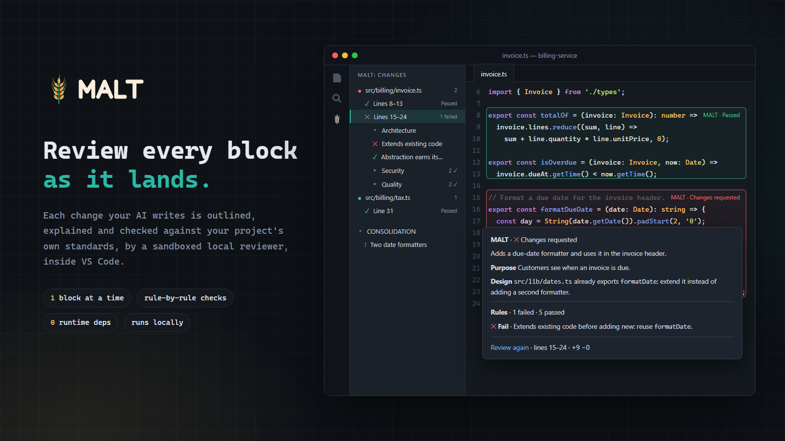
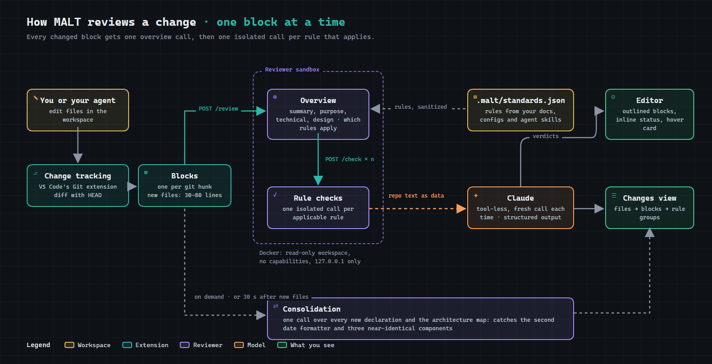

<div align="center">



# MALT

### Multi-Agent Local Team

**Review changed code, explore project architecture, and compare branches inside VS Code.**

A VS Code extension for teams who ship with AI and still care what lands in `main`.

<br />

[](https://github.com/Division4Studios/multi-agent-local-team/actions/workflows/ci.yml)
[](https://github.com/Division4Studios/multi-agent-local-team/actions/workflows/codeql.yml)
[](LICENSE)
[](https://github.com/Division4Studios/multi-agent-local-team/stargazers)
[](https://github.com/Division4Studios/multi-agent-local-team/network/members)
[](https://github.com/Division4Studios/multi-agent-local-team/issues)
[](https://github.com/Division4Studios/multi-agent-local-team/commits/main)

[](https://code.visualstudio.com/)
[](tsconfig.base.json)
[](eslint.config.mjs)
[](SECURITY.md#supply-chain-policy)
[](.nvmrc)
[](CONTRIBUTING.md)
[](https://discord.gg/DwSpsGjvFY)
[](CODE_OF_CONDUCT.md)

[**Why MALT**](#-why-malt) ·
[**Principles**](#-principles) ·
[**Getting started**](#-getting-started) ·
[**How we build**](#-how-we-build-malt) ·
[**Contributing**](#-contributing) ·
[**Security**](#-security)

</div>

---

> [!NOTE]
> MALT is in **early development** (preview). Star and watch the repo to follow along.

## Guides

- [First review and installation](docs/getting-started.md)
- [Ten interactive architecture views, checked exports, and local-agent connections](docs/architecture-views.md)
- [Explore the architecture, compare branches and clarify design intent](docs/architecture-explorer.md)
- [Settings and commands](docs/configuration.md)
- [Standards, ignored instructions, and generated output](docs/standards.md)
- [Troubleshooting and current limitations](docs/troubleshooting.md)
- [Editor acceptance checks](docs/editor-testing.md)
- [Architecture](docs/architecture.md) · [Visual design and assets](docs/design.md)

**Two file policies:** micro-reviews skip Git-ignored changes; standards discovery still reads supported instructions in ignored folders. Generated `.malt/` output is excluded from both and gets its own `.gitignore` when standards are saved.

## 💡 Why MALT

AI coding tools made it cheap to *open* pull requests and expensive to *review* them. Teams are drowning in large, plausible-looking, under-explained diffs, and reviewers become the bottleneck — or worse, the rubber stamp.

MALT is a layer that works **locally, inside VS Code**, between the code your AI tools produce and the PR your teammates have to read. Its job: make sure what reaches review is **smaller, clearer, verified and safe**, so good changes merge faster and slop never makes it to the queue.

## ✨ What it does

| | |
|---|---|
| 🔲 **Outlines every change as it lands** | When you or a coding agent edits a file, MALT brings it into view and draws a box around each changed block. No hunting through a giant diff. |
| 🔬 **Surgical, per-rule review** | Each block gets a short overview call that sorts out which rules apply, then one focused, isolated call per applicable rule, so no rule gets lost among forty others. |
| 💬 **Hover to understand** | Hover an outlined block for its **business purpose** in plain language, a **technical** description, a skeptical **design** take (should this new abstraction exist, or extend existing code?), then the rule results. |
| 🗂️ **Rules by group** | In **Changes**, expand a block to see its rules in collapsible groups, sorted running → failed → passed → not run → not applicable. Select a checked rule for a full-page explanation. |
| 📏 **Standards from your own repo** | **Scan Project Standards** reads your `.claude`/`.codex`/`.agents` skills, docs and lint configs and distills short, checkable rules into `.malt/standards.json`. |
| 🔍 **Finds the gaps in your standards** | The scan then compares your docs with your code. Conventions the code clearly follows but no doc states become rules marked *Inferred from code*; what neither settles (no architecture doc, two competing patterns) is listed as gaps for the team to decide. |
| 🧭 **Knows what already exists** | The same scan maps your source files (purpose, exports and explanations with their evidence) into `.malt/architecture.json`. Each block review gets only the related slice, so the reviewer can say "extend the existing `Modal`" instead of guessing. |
| **Interactive architecture map** | Open **Reviewer → Architecture** to explore dependencies, trace calls, compare branches and clarify the reviewer's understanding of design intent. |
| 🧩 **Consolidation across the change** | One call compares the new declarations across every changed file, and against the map, to catch three near-identical components or a second date formatter. It runs on demand, or 30 seconds after new files stop appearing. |
| 🔀 **Review a pull request** | Pick an open PR on GitHub; MALT checks it out safely, outlines every changed block and reviews it like your own changes. Results stay in VS Code; **Finish** takes you back to your branch. |
| 🐳 **Always-hot, isolated reviewer** | The reviewer runs in a hardened Docker container (read-only workspace, no privileges, localhost-only), or as a local daemon when Docker isn't available. |
| 🗂️ **Sidebar & status bar** | A MALT sidebar shows reviewer health and every changed block, and the status bar keeps a running pass/concern/fail count. |

## 🔁 How it works

<p align="center"></p>

Code under review can try to talk to the reviewer, so repository text only ever reaches the model as fenced data, and every answer is checked before you see it. See [the trust boundary](SECURITY.md#the-trust-boundary).

## 🧭 Principles

| | |
|---|---|
| 🏠 **Local first** | The reviewer runs on your machine. Claude requests send selected code and context to the configured model service. |
| 🛡️ **Safe by default** | Zero runtime dependencies. Native builds use an isolated container; linting retains Node permission restrictions. |
| 🔍 **Verifiable** | Nothing is "trust me". Every claim about a change should be checkable. |
| ⚡ **Faster merges, not more PRs** | The goal is reviewer time saved, not AI output multiplied. |
| 🧑‍⚖️ **Humans stay accountable** | MALT assists the people who own the code; it never replaces their judgment. |

## 🚀 Getting started

**Install a release** (VS Code 1.144+):

1. Download `malt-X.Y.Z.vsix` from the [latest release](https://github.com/Division4Studios/multi-agent-local-team/releases/latest). MALT is not on the VS Code Marketplace.
2. In VS Code, run **Extensions: Install from VSIX…** and select the file.
3. Open a git repository and click the **MALT** icon in the activity bar.

Every release is built by GitHub Actions from a signed tag, with a checksum and a provenance attestation you can check with `gh attestation verify`. See [Install and verify a release](docs/releasing.md#install-and-verify-a-release).

**Run from source** instead, to develop MALT. Prerequisites: [Node.js 24+](https://nodejs.org/), [VS Code 1.144+](https://code.visualstudio.com/), and Docker with a running Linux engine. See the [TypeScript 7 toolchain guide](docs/toolchain.md).

```sh
git clone https://github.com/Division4Studios/multi-agent-local-team.git
cd multi-agent-local-team
npm ci
```

Then open the folder in VS Code and press <kbd>F5</kbd>. A new **Extension Development Host** window opens with MALT loaded. Open a git repository in it and click the **MALT** icon in the activity bar.

**Reviewer requirements** (one of):

- 🐳 **Docker Desktop** running, plus a Claude credential saved with **MALT: Set Claude Credentials**: a subscription token from `claude setup-token`, or an Anthropic API key. Stored in your OS keychain.
- 💻 **[Claude Code](https://docs.claude.com/en/docs/claude-code) CLI** installed and logged in. MALT uses it as a local daemon when Docker isn't available.

### Settings

| Setting | Default | |
|---|---|---|
| `malt.reviewer.autoStart` | `true` | Start the reviewer when a workspace opens |
| `malt.reviewer.claudePath` | `claude` | Host CLI executable path (user settings only) |
| `malt.docker.socketPath` | empty | Docker socket/pipe override (user settings only) |
| `malt.reviewer.backend` | `auto` | `auto` (Docker if ready, else host), `docker` or `host` |
| `malt.reviewer.triageModel` | `sonnet` | Model for each block's overview and rule sorting |
| `malt.reviewer.reviewModel` | `sonnet` | Model for each per-rule check |
| `malt.reviewer.standardsModel` | `opus` | Model for **Scan Project Standards** |
| `malt.reviewer.maxConcurrentReviews` | `2` | Parallel reviewer calls |
| Models & effort | Haiku/low for rule checks, Sonnet/low for overviews | Change per review type from **Models & effort** in the Reviewer view |
| `malt.changes.autoOpen` | `true` | Bring changed files into view (without stealing focus) |
| `malt.changes.autoOpenPauseSeconds` | `60` | Hold auto-open while you are working, so it never pulls you away from what you are investigating |
| `malt.changes.autoReview` | `true` | Review new blocks automatically |

### Commands

| Command | What it does |
|---|---|
| `npm run compile` | Compile with TypeScript 7 in Docker; host writes restricted to `out/` |
| `npm run watch` | Recompile on change (used by <kbd>F5</kbd>) |
| `npm run check-types` | TypeScript 7 checks the extension and repo scripts in Docker |
| `npm run lint` | ESLint, strictest type-aware rules, **zero warnings allowed** |
| `npm run check-deps` | Enforce the dependency allowlist and exact pinning |
| `npm run audit` | Fail on low and higher advisories, including development tools; verify registry signatures |
| `npm run test:toolchain` | Verify dependency policy, compiler aliases and ESLint/VSCE file selection |
| `npm run test:compiler-sandbox` | Actively verify the native compiler container restrictions |
| `npm test` | Compile, then run the tests inside a real VS Code instance |
| `npm run verify` | Everything CI runs: deps → types → lint → tests |
| `npm run vsix` | Package the extension as a `.vsix` |
| `npm run release:bump -- <major\|minor\|patch>` | Start a release: set the next version and date its changelog section ([Releasing](docs/releasing.md)) |

## 🏗️ How we build MALT

A tool that keeps slop out of other repos has to keep it out of its own first. This repository holds itself to the bar MALT is meant to enforce:

- **Strictest TypeScript.** `strict` plus `noUncheckedIndexedAccess`, `exactOptionalPropertyTypes`, `erasableSyntaxOnly` and more — see [`tsconfig.base.json`](tsconfig.base.json).
- **Strictest lint, no escape hatches.** `typescript-eslint`'s `strictTypeChecked` + `stylisticTypeChecked`, extra correctness and security rules, every rule an **error**, and inline `eslint-disable` comments are **ignored**. Changing a rule means changing [`eslint.config.mjs`](eslint.config.mjs) in a reviewed PR.
- **No type assertions, no `any`, no `!`, no `@ts-ignore`.** If the types don't prove it, the code doesn't ship.
- **Isolated native builds.** TypeScript 7 runs in Docker without external network access, with read-only inputs and host writes restricted to `out/`. ESLint uses Microsoft's TypeScript 6 compatibility API and retains Node permission restrictions. Those restrictions are safeguards, not a boundary against malicious code. See the [toolchain guide](docs/toolchain.md).
- **Tiny, frozen toolchain.** A fixed allowlist of dev tools, exact versions, a committed lockfile, install scripts disabled, and CI that fails if anything else appears. See [Supply-chain policy](SECURITY.md#supply-chain-policy).
- **Protected, signed history.** Every change reaches `dev` through a reviewed pull request whose commits are all signed, with every check green and no new CodeQL alerts; `main` only takes releases from `dev`. Nobody can bypass that, maintainers included. See [repository settings](docs/repository-settings.md).
- **Verifiable releases.** Each release is built by GitHub Actions from a signed tag on `main`, after the full CI matrix, from JavaScript byte-identical to what CI tested, with a SHA-256 checksum and a signed provenance attestation. See [Releasing](docs/releasing.md).
- **AI-assisted contributions welcome — with disclosure and ownership.** See [CONTRIBUTING.md](CONTRIBUTING.md#ai-assisted-contributions).

## 💬 Community

The [**MALT Discord**](https://discord.gg/DwSpsGjvFY) is where people building with MALT talk. It stays focused on building: reviewing AI-assisted changes, architecture and the tools around them.

- 👋 **#introductions**: say what you're building
- 🗺️ **#architecture-maps**: share a diagram you exported with **Finalize and export** ([how](docs/architecture-views.md#publish-a-checked-standalone-artifact))
- 🚀 **#showcase**: show something you shipped with MALT
- ❓ **#help** and **#faq**: setup and usage questions
- 🎯 **#wrong-verdicts**: talk through a review MALT got wrong (then [file it](https://github.com/Division4Studios/multi-agent-local-team/issues/new?template=review_quality.yml) so it's tracked)
- ✨ **#ideas** and 🛠️ **#dev-chat**: shape features and work on MALT itself
- 📦 **#releases** and **#shipped**: every release and merged pull request

New members can chat straight away. Posting links and files unlocks after a little activity, which keeps spam out. Anything that needs a record (bugs, decisions) becomes a GitHub issue, and security reports never go to Discord ([SECURITY.md](SECURITY.md)).

## 🤝 Contributing

Contributions are welcome! Please read [**CONTRIBUTING.md**](CONTRIBUTING.md) before opening a pull request, and follow our [**Code of Conduct**](CODE_OF_CONDUCT.md). Work happens on **`dev`**: branch from it and open pull requests against it. `main` only receives releases from `dev`.

- 🐛 Found a bug? [Open a bug report](https://github.com/Division4Studios/multi-agent-local-team/issues/new?template=bug_report.yml)
- 🎯 MALT got a verdict wrong? [Report a wrong review result](https://github.com/Division4Studios/multi-agent-local-team/issues/new?template=review_quality.yml)
- 💬 Want to talk? [Join the MALT Discord](https://discord.gg/DwSpsGjvFY): help, ideas, development and office hours
- ✨ Have an idea? Discuss it in #ideas on Discord, or [request a feature](https://github.com/Division4Studios/multi-agent-local-team/issues/new?template=feature_request.yml)
- ❓ Need help? Ask in #help on Discord, [ask in Discussions](https://github.com/Division4Studios/multi-agent-local-team/discussions/categories/q-a) for a searchable answer, or see [SUPPORT.md](SUPPORT.md)

## 🔒 Security

Please **do not** report security vulnerabilities in public issues. See [**SECURITY.md**](SECURITY.md) for how to report privately and for our supply-chain policy.

## 📄 License

MALT is open source under the [MIT License](LICENSE).

<div align="center">
<br />
<sub>Built with care for reviewers everywhere.</sub>
</div>
