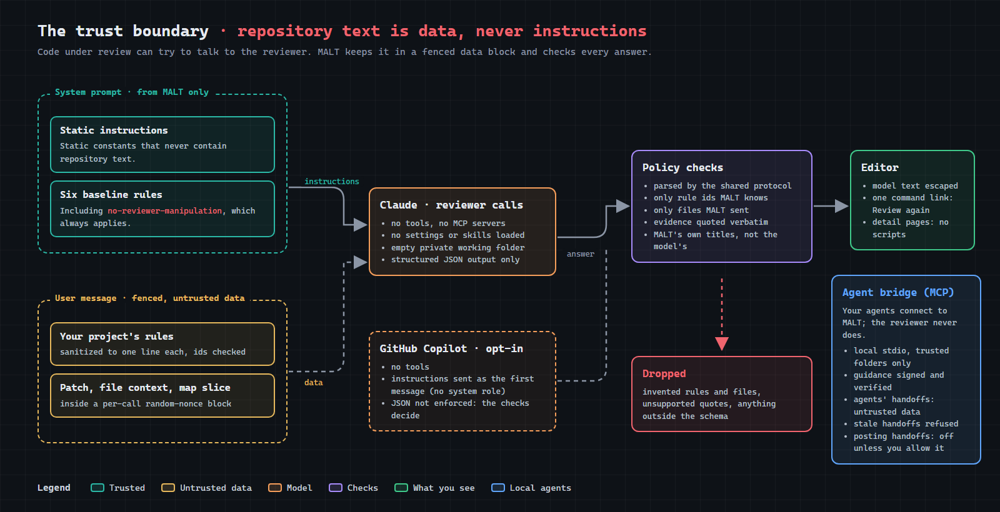

# Security Policy

## Supported versions

MALT is pre-1.0. Only the latest release (and `main`) receives security fixes.

| Version | Supported |
|---|---|
| latest / `main` | ✅ |
| older | ❌ |

## Reporting a vulnerability

**Please do not report security vulnerabilities through public GitHub issues, discussions or pull requests.**

Report privately through either:

- GitHub's [private vulnerability reporting](https://github.com/Division4Studios/multi-agent-local-team/security/advisories/new) (**Security** tab → **Report a vulnerability**), or

Please include:

- A description of the issue and its impact
- Steps to reproduce, or a proof of concept
- Affected versions or commits
- Any suggested fix

What to expect:

- **Acknowledgement** within 3 business days
- **Initial assessment** within 7 days
- Coordinated disclosure: we will agree on a timeline with you, publish a GitHub Security Advisory, and credit you unless you prefer to stay anonymous

## The trust boundary

Code under review can try to instruct the reviewer. MALT keeps everything from the repository out of its instructions and checks every answer; the details are under **Prompt-injection boundary** below.

## Reviewer isolation

MALT sends changed code to a reviewer service that calls an AI model. It's designed so that the reviewed repository can't use the reviewer to run code:

- **Docker backend (preferred):** the workspace is mounted **read-only**, with a read-only root filesystem, all Linux capabilities dropped, `no-new-privileges`, memory and PID limits, and the API port published on **127.0.0.1 only**. The extension manages Docker through the Engine API (`node:http` over the local socket or named pipe) and never runs the Docker CLI.
- **Host backend (fallback):** the same service runs as a local process bound to 127.0.0.1. The model CLI it calls runs with your user's permissions, which is why Docker is preferred.
- **Per-start bearer token** on every request, compared in constant time.
- **Workspace confinement by real path.** Every file the reviewer reads is opened and then verified:
  - its real path (after following symlinks and junctions) is inside the real workspace root;
  - the opened handle is the same file as that path, so it can't be swapped mid-read;
  - it is a regular file with a single link (no hard links);
  - it was opened non-blocking, so a named pipe can't hang the reviewer.

  A repository therefore can't use links to pull files from elsewhere on the machine into a prompt. Regression tests cover junctions, hard links and the standards scan.
- **Model calls have no tools.** Each call to `claude -p` uses `--tools ""`, `--strict-mcp-config`, `--setting-sources ""` and a temporary working directory, so no tools, MCP servers, hooks, settings or `CLAUDE.md` from the reviewed repository are loaded. Output must match a JSON schema and is validated again by MALT.
- **Prompt-injection boundary.** Everything from the reviewed repository counts as untrusted: project rules in `.malt/standards.json`, patches, file contents and the docs read by the standards scan.
  - The system prompts are static and contain no repository text.
  - Repository content goes in the user message as data, inside blocks marked with a random per-request code, so content can't fake the end of its block.
  - Project rules are sanitized (control and invisible characters removed, whitespace collapsed, lengths and count capped, ids validated, baseline rules can't be shadowed) and sent as JSON.
  - The architecture map (`.malt/architecture.json`) is generated from repository files, so it is untrusted too. It only keeps paths the scan actually read, is sanitized like project rules, and is sent as JSON data. Consolidation findings and standards gaps may only name files MALT showed the model. Rules the scan infers from code are sanitized like documented rules, can't shadow baseline or documented rules, and MALT (not the model) marks their source as inferred.
  - A baseline check, `no-reviewer-manipulation`, fails any code, comment or rule that tries to steer an AI reviewer. It runs on every block, whatever the overview call decided applies, so injected text can't talk the reviewer out of it.
- **GitHub Copilot is opt-in and has a weaker instruction boundary.** A review type can be set to Copilot (`malt.reviewer.<type>Provider`). That setting is machine-scoped, so only you can choose it; a repository's settings can't switch where its code is sent.
  - **Where the call runs:** the reviewer still builds the prompt and checks the answer. It hands the call to the extension over its existing authenticated local port, and the extension runs it through VS Code's Language Model API, with your consent and no tools.
  - **What's weaker:** that API has no system role, so MALT's static instructions are sent as the first user message, with the repository data (in the same marked blocks) in the second. Repository text never enters the instructions, but the model sees both as user messages, so injected text can imitate instructions more easily than with Claude's system prompt.
  - **The answer:** Copilot doesn't enforce the JSON schema, so the answer goes through the same parsers, rule-id and file checks, quote grounding and the always-on `no-reviewer-manipulation` check as Claude's. Anything that doesn't fit fails the call.
  - **Where your code goes:** the redacted prompt, so GitHub Copilot and the model vendors behind it receive the same code Claude would.
- **MALT doesn't take the model's word for it.** The overview call can only name rules MALT knows. Each rule is checked in its own call; the reviewer looks the rule up itself, takes the id and title from its own list, and sanitizes the model's text. A block passes only when every applicable rule has a passing check; one failing check makes it fail.
  - Residual risk: a model can still be persuaded to mark a rule as passed. MALT's verdicts help the people reviewing a change; they don't replace them.
- **No temporary files with secrets or prompts.** Each model call runs in a fresh private directory that is deleted afterwards (`mkdtemp`, mode 0700).
- **The extension never follows links out of the workspace either.**
  - Changed files are reviewed only if they are regular files whose real location is inside the workspace. Symlinks, and files reached through linked folders, are never read, outlined or sent to the reviewer.
  - Opening a gap or finding resolves the file's real path and refuses anything outside the workspace (failing closed if it cannot be resolved).
- **Local agents and artifact delivery.** The stdio MCP bridge verifies a workspace-bound signature with a public verifier supplied through VS Code. Peer handoffs are revision-scoped, untrusted agent messages. A repository cannot use a handoff to confirm developer intent. The bundled MALT publisher runs as a user-invoked VS Code process task with separate arguments. The browser check uses a private Chrome profile and debugging pipes. The HTML uses an offline content security policy and escaped repository text. Exported source labels, excerpts, and model interpretations can contain project information.

- **Architecture exploration and discussion.** Working maps use confined source reads in trusted local workspace folders. Historical comparisons read pinned commits through the built-in Git extension. Local indexing needs no credentials. Opening a discussion sends bounded source and graph context to the configured reviewer. The service treats repository excerpts, prior replies and developer statements as data. A matched quote establishes that the excerpt occurs in the supplied code. The model still interprets what it means. Saved clarifications are attributed to the developer and scoped to the branch, file path and content fingerprint. Local caches can contain project source excerpts and design decisions.

- **Gap investigations** read real code, and only source code. Reads go through the confined reader (real-path containment, regular files only). A gap's file list is untrusted (`standards.json` lives in the repository), so it is narrowed to files that are both mapped by the scan and source code. Every file read (the gap's, other exporters', and one hop of relative imports) must pass `isSourceCodePath`: a code extension, with no hidden or dependency folder anywhere on the path. A tampered list or an `import` can therefore never pull `.env`, keys, JSON secrets or notes into a model call. File count and total size are capped. The request names a gap by id, and the reviewer looks it up in its own copy of `.malt/standards.json`, so a caller cannot supply gap text. Code is passed as data under the static system prompt. Evidence quotes must appear verbatim in a file MALT supplied, or they are discarded.
- **Reviewing a pull request.** A PR is code from someone else, so everything about it is untrusted.
  - GitHub is reached only at `api.github.com` over HTTPS, with a token from VS Code's built-in GitHub sign-in. MALT only reads, so it signs in read-only (`read:user`); GitHub has no read-only scope for private repositories, so the full `repo` scope is requested only when the repository is not visible read-only, after a prompt that says so (or reused if already granted). The token is never logged, stored by MALT or passed to the reviewer. Responses are size-capped and validated; the head commit must be a full SHA.
  - The PR is checked out with VS Code's Git extension (MALT never runs git). It refuses while you have uncommitted tracked changes, checks out GitHub's exact head commit and verifies HEAD before reviewing. If the workspace then leaves that commit or its files are changed, the review stops for good, so the reviewer never reads files that are not the PR's. Symlinks in a PR are skipped, never followed. A PR that changes anything in a `.malt` folder is refused: MALT takes its review rules from there, so the PR would choose its own rules. Finishing refuses rather than discard anything changed on the checkout.
  - The PR is read again just before checkout, and its head is read again after its patches are loaded: if the author pushed in between, loading fails instead of reviewing patches against files from another commit. Any failure after checkout returns you to your branch.
  - Finishing stops the review first (nothing new starts; queued work is dropped) and waits for calls already running, so no reviewer call reads your branch's files as if they were the PR's.
  - File names in the PR's diff must resolve, by real path, inside the workspace folder; links out of it and `../` names are skipped. Blocks are capped per PR.
  - Checking out a PR puts its files in your workspace. VS Code may run tasks, debug configurations or extensions configured by those files. MALT itself never executes PR content, and the settings that pick what MALT runs (`malt.reviewer.claudePath`, `malt.docker.socketPath`) are machine-scoped, so a repository's `.vscode/settings.json` cannot set them.
  - Results are in memory only and nothing is posted to GitHub.
- **Live reviewer log.** It shows each model call as it happens, and is never written to disk. The reviewer keeps a bounded in-memory backlog, serves it only on `GET /events` with the per-start token, and drops viewers that stop reading. Shutdown closes open streams.
  - Recognizable secrets are redacted before anything is logged: API keys (Anthropic, OpenAI, AWS, GitHub, Slack, Google, Stripe, npm), JWTs, bearer tokens, private-key blocks, credentials in URLs, and secret-named string literals or `.env` lines. Streamed text is released word by word, so a secret split across chunks is still caught.
  - Every prompt is redacted the same way before it reaches any provider (one point, `ReviewService.ask`), so patches and file context never carry a recognizable credential to Claude or GitHub Copilot. The `no-secrets` check still catches it: its rule says `[REDACTED]` marks a credential MALT found and removed, so a block that had one fails without the model ever seeing the value.
  - The log page loads only `media/liveLog.js` under a nonce CSP, sets text only, and ignores messages from any origin but its own (how VS Code delivers extension messages).
- **Untrusted output stays inert.** Review text is escaped when rendered in hovers; the only command link enabled is MALT's own "Review again". The rule detail page HTML-escapes every value, has scripts disabled, and its content security policy allows only its own nonce-tagged stylesheet.
- **Credentials** live in VS Code SecretStorage (your OS keychain) and are passed only to the reviewer.
- Extension process execution is limited by lint policy to the host backend and Claude Code provider. The development-only `scripts/compiler.mts` launcher has a separate exception to invoke Docker without shell interpolation; it is not packaged with the extension.

## Supply-chain policy

MALT is designed to keep its attack surface as small as possible.

**What ships to users**

- The published extension has **zero runtime dependencies**. The `.vsix` contains only the compiled extension and reviewer, branding assets, guides, the reviewer `Dockerfile`, `package.json`, the README, the changelog and the license; `.vscodeignore` is an allowlist. Development-tool dependencies are not packaged.
- The reviewer image is built locally from a base image pinned by digest (`node:24-slim@sha256:…`), with the Claude Code CLI pinned to an exact version.

**What runs on developer and CI machines**

- A fixed allowlist of development tools, enforced by `npm run check-deps` in CI: `@typescript/native` (an exact alias to TypeScript 7), `typescript` (an exact alias to Microsoft's TypeScript 6 compatibility package), `@types/node`, `@types/vscode`, `eslint`, `@eslint/js`, `typescript-eslint`, `@vscode/test-electron`, `@vscode/vsce`. No other alias targets are permitted.
- Every version is pinned exactly, `package-lock.json` (with integrity hashes) is committed, and CI installs with `npm ci`.
- Dependency overrides are forbidden except for the exact, parent-version-scoped minimatch security exceptions below. `npm run check-deps` rejects broader overrides or other replacement versions. `resolutions` remain forbidden. Published registry artifacts and integrity hashes are recorded in the lockfile; no dependency source is edited after installation.
- Package install scripts are disabled (`ignore-scripts=true` in `.npmrc`).
- Registry signatures and provenance are verified in CI (`npm audit signatures`).
- Native TypeScript 7 compilation, type-checking and watch mode run in a digest-pinned Docker Linux image, with networking disabled, read-only source mounts and root filesystem, a non-root user, all capabilities dropped, `no-new-privileges`, and CPU/memory/PID limits. Only compilation/watch receive a writable `out/` mount. A bounded temporary filesystem is writable inside the container. No host credentials, Docker socket, `.git/`, or `.malt/` are mounted. The launcher fails if Docker is unavailable; it never falls back to unrestricted native compilation. Image installation needs network access; compiler execution does not. See [the toolchain guide](docs/toolchain.md).
- Linting and the dependency guard retain **Node.js permission restrictions** with read-only filesystem access and no child processes, workers or native addons. These are safeguards against accidental access, **not a security boundary against malicious code**, as explained in [Node's permission documentation](https://nodejs.org/api/permissions.html). Native child processes do not inherit these restrictions, which is why compilation uses a container. Container isolation still relies on a trusted, patched Docker engine and host kernel; the launcher, npm installation, tests, editor extensions, and packaging tools execute with host permissions.
- GitHub Actions are limited to first-party `actions/*` and `github/*` actions, **pinned to full commit SHAs**, with least-privilege `permissions`.
- Dependabot proposes updates; every update goes through the same CI gate and human review.

**Audit gate**

`npm run audit` fails on low, moderate, high, or critical advisories anywhere in the dependency tree, including development tools, then verifies registry signatures and provenance. Dependency review also rejects newly introduced advisories at low severity or above. Audit failures are investigated and remediated; the threshold is not lowered to pass CI.

### Temporary minimatch security overrides (2026-11-03)

[GHSA-g3hv-75wg-m249 / CVE-2026-118764](https://github.com/advisories/GHSA-g3hv-75wg-m249) describes excessive CPU and memory use with attacker-controlled patterns at `optimizationLevel >= 2`. The advisory identifies versions below 11.0.1 as affected. MALT replaces all four affected dependency paths with published **minimatch 11.0.4**:

| Exact parent | Upstream range | Reviewed override |
|---|---|---|
| `@vscode/vsce@4.1.0` | `^10.2.6` | `minimatch@11.0.4` |
| `eslint@10.14.0` | `^10.2.6` | `minimatch@11.0.4` |
| `@eslint/config-array@0.23.5` | `^10.2.4` | `minimatch@11.0.4` |
| `@typescript-eslint/typescript-estree@8.72.1` | `^10.2.2` | `minimatch@11.0.4` |

This is a MALT compatibility decision, not an upstream endorsement of minimatch 11 for these releases. npm explicitly supports [overrides for vulnerable transitive dependencies](https://docs.npmjs.com/cli/v11/configuring-npm/package-json/#overrides). The exception applies only to the listed parent versions. It cannot silently apply to future parent releases. The dependency guard also rejects any root or nested minimatch lock entry below 11.0.1, including versions introduced by new dependency paths.

Minimatch 11 removes APIs and changes some matching semantics. These parent releases use `minimatch()`, `Minimatch`, and `.match()`, rather than removed APIs such as `makeRe()`. `npm run test:toolchain` verifies ESLint and VSCE file selection with nested paths, dotfiles, exclusions and negations, checks that lint suppression cannot disable the test rule, checks the real package allowlist, and exercises rejection of unreviewed overrides and vulnerable nested lock entries. CI runs these checks on Windows, Linux and macOS alongside the existing strict linting and extension tests. No ESLint rule is relaxed for this upgrade.

**Removing the exception:** inspect each Dependabot parent update. When its supported dependency range admits a patched minimatch, remove that parent's override and its approved entry in `scripts/security-overrides.mts`. If an updated parent still requires an affected release, review compatibility and update the exact exception explicitly; do not broaden it to an unversioned parent. Run `npm ci`, `npm run verify`, `npm run audit`, `npm ls minimatch --all`, and `npm run vsix`. Confirm there are no affected minimatch versions and inspect the archive for unintended files. Remove the remaining exception machinery once all parent dependencies support patched releases; keep the regression checks and strict audit gate.

Minimatch is development-only and is absent from the shipped extension and reviewer. Node's permission model does not prevent CPU or memory exhaustion; neither sandboxing nor a CI timeout substitutes for this dependency fix. [Dependabot alert #1](https://github.com/Division4Studios/multi-agent-local-team/security/dependabot/1) should close through GitHub's dependency analysis after the fixed lockfile reaches the default branch, rather than through manual dismissal.
