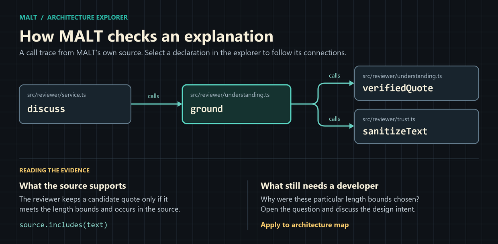

# Explore a project's architecture

Open a trusted local project in VS Code and select **MALT → Reviewer → Architecture**. With several workspace folders open, select the folder to explore. The initial map shows the project and its immediate children. Structural indexing starts automatically and works with the reviewer stopped.

## Follow a process through the code

To try the example below, open MALT's own repository.

1. Search for **discuss** and select the declaration in **src/reviewer/service.ts**. **Open source** opens the method in an editor beside the map.
2. Set **Connections** to **calls**. Select **ground** to see which helpers check the model's answer. **Back** returns to the previous focus. Breadcrumbs jump to a containing declaration, file, folder or the project.
3. To keep the whole route visible, return to **discuss** and select **Start here**. Search for **verifiedQuote**, select the declaration in **src/reviewer/understanding.ts**, then choose **Find path to here**. Each step in the resulting path is clickable.

For a UI hierarchy, select **inherits** or **implements** on a class. For a JSX component, select **renders**. Use **Tag** to narrow by language, UI, test, service, data or understanding status. **Previous connections** and **Next connections** page through large neighbourhoods. Use **Fit** after resizing the editor. Focus a map card with Tab and activate it with Enter or Space.

## Understand what the agent knows

**Scan Project Standards** asks the configured reviewer to interpret sampled implementations in the first workspace folder. To analyze a specific file in any mapped folder, select a file or declaration and choose **Discuss or clarify with reviewer…**. A declaration supplies the starting location for the discussion. Explanations and accepted clarifications belong to the file.

| What you see | How to read it |
| --- | --- |
| **What · source evidence** | The agent describes behavior and supplies a short excerpt MALT found in the analyzed source. You can inspect the excerpt and open the file. |
| **Why · documented rationale** | The agent identifies an explicit reason in the source. MALT checks that the quoted text exists. The connection between the quote and the explanation is still the agent's judgment. |
| **Working hypothesis** | The agent has a possible explanation without a verified supporting excerpt. Select the open question to discuss it. |
| **Developer clarification** | Someone explicitly applied this wording for the current branch and file version. Later architecture-aware reviews receive it as attributed project context. |

For example, a queue may visibly buffer writes while its reason for buffering remains uncertain. Select the question, explain that the queue preserves ordering during reconnect, and ask the reviewer to revise its interpretation. You can send further replies. Edit the proposed **Developer clarification** and choose **Apply to architecture map** when it reflects your intent. The structural map, file summaries and future review context then use the saved understanding.

Structural indexing and branch comparisons run locally. A standards scan or discussion sends bounded code and context to your configured reviewer. Each discussion turn that requests an answer makes a model call using the investigation profile. If the reviewer is unavailable, you can still enter and apply your own clarification.

## Compare two branches

1. Choose **Compare branches…**, select the base, then choose a target local branch. Select **Current working tree** as the target to include saved local edits.
2. Enable **Changes only**. Follow a changed folder down to its declarations. A plus marks an addition, a minus with a dashed outline marks a removal, and a tilde marks a change. The comparison includes relationships as well as nodes. Renames appear as a removal and addition.
3. Use **Trace in** to trace the base or the target independently. A removed declaration opens source from the base commit. Select **Working tree** to resume live navigation and clarification.

MALT reads branch tips through VS Code's Git provider. You can compare a branch you have never opened. The comparison leaves HEAD, the index and saved local edits in place.

## What is indexed and saved

| Event | Result |
| --- | --- |
| Open a folder, create or delete a source file, change ignore rules, commit or check out a branch | MALT rebuilds the working map. A checkout invalidates the previous in-flight scan. |
| Save an existing source file | MALT re-reads the file and resolves relationships against the updated index. |
| Compare branch tips | The exact commit IDs are read and cached. Select the branches again to compare newer tips. |
| Rescan after accepting a clarification | The developer's wording survives on the same branch while the file fingerprint matches. A new file version needs fresh evidence. |

Generated files live under `.malt/maps/v1/`. The `branch-` and `commit-` files hold graph snapshots, `scan-` files hold branch analyses, and `note-` files hold accepted clarifications keyed by branch, path and source fingerprint. `reviewer.json` supplies current explanations to the reviewer. File names use hashes so branch names containing slashes remain safe. Generated files stay local through the directory's ignore file.

The structural index covers up to 6,000 eligible source files of up to 512,000 bytes each. The view reports skipped files. Static matching supports relative JavaScript/TypeScript imports, Python from-imports, common base type lists, local and imported calls, and JSX components. Other recognized source types have folder, file, language and matching declaration nodes. Dynamic dispatch, package aliases and generated code can leave connections unresolved. A path search follows only resolved directed edges.

See [standards discovery and reviewer context](standards.md) for the separate model scan limits.
