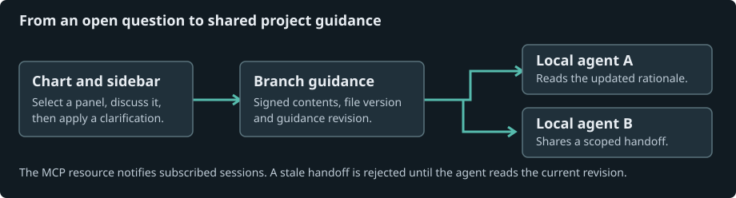

# Ten views of a project

Open **MALT → Architecture Explorer** in the VS Code sidebar. Expand a workspace, choose a view, and select a subject. Expand the subject again to inspect its parts or follow a relationship without leaving the sidebar. **Reviewer → Architecture** opens the same explorer in an editor.

The **View** selector carries a selected subject into another view when they share an identity. **Related views** offers exact matches. **Previous view** returns to the previous selection. **Reveal in sidebar** expands the active subject there. Use **Compare branches** to select two revisions. The connection map overlays changes and the other screens let you switch between the base and target.

| View | What you can inspect | Evidence MALT uses |
| --- | --- | --- |
| Architecture | Project overview, a component’s children, subsystem responsibilities and security or infrastructure boundaries | Code relationships, agent-defined subsystem names, Terraform declarations, Compose services and dependencies, Docker build stages |
| Workflow | Steps in each lane and dependencies across lanes | GitHub Actions jobs, steps and needs, agent interpretations or authored stages |
| Sequence | Participants, ordered messages, repeated calls and explicit returns | Resolved call sites in source order, agent interpretations or authored messages. Source order alone cannot establish execution order. |
| Data flow | Producers, consumers, destinations and named transfers | SQL writes from SELECT and JOIN, agent interpretations or authored flows |
| Lifecycle | States, transitions, waits, retry loops, entry and exit | Mermaid state diagrams in `.mmd` or `.mermaid` files, agent interpretations or authored transitions |
| Entity–relationship | Table definitions, all parsed columns, primary, foreign and unique constraints, and crow’s-foot ends | SQL CREATE TABLE, inline and table-level constraints. Nullability and uniqueness constrain each end. |
| Class / interface | Members and contracts, inheritance, realization, composition and dependencies | Resolved declarations, typed member signatures and explicitly constructed fields. Owned-field composition is a static inference. |
| Tree | One root, successive levels, parents and children | The repository’s folder, file and declaration hierarchy, or an authored taxonomy |
| Timeline | Events on a time axis, UTC/local display and marked breaks in stretches longer than seven days | Up to 120 Git commits at the selected revision or authored timestamps with explicit offsets |
| Waterfall | Nested durations and overlapping work on a common clock | Complete-duration Chrome trace events (`ph: "X"`) in `*.trace.json` or authored spans. Trace microseconds are converted to milliseconds. |



Run **MALT: Scan Project Standards (Rescan)** for the reviewer’s interpretation. It reads bounded samples of the implementation and project guidance, groups files by the responsibilities it finds, and can suggest relationships across systems. Infrastructure discovery extracts declaration names and dependency names. The infrastructure reader omits environment values. A suggested relationship with no matching source quote is labeled **Hypothesis**. A matching quote proves that the text occurs in the sample. A developer can clarify its meaning.

**Discuss this panel** opens the reviewer with the selected item and bounded context. Edit and apply its proposed explanation. The working map, later reviews and connected agents then receive the clarification. **Copy panel question** includes the selected passage, view, item, branch and commit for a follow-up in another agent. Git history and observed timings remain independent of model interpretation.

## Describe a domain the source cannot express

A file ending in `.malt-model.json` can describe people, accounts, operational steps or design intent alongside the code. Store the authored file in your repository outside `.malt`. Give a subject the same **ref** in different views to make navigation between them explicit. Save this example as `household.malt-model.json` and select the account in either view.

```json
{
  "version": 1,
  "diagrams": [
    {"id":"accounts","kind":"architecture","title":"Household accounts","items":[
      {"id":"checking","label":"Checking account","group":"Accounts","ref":"household:checking"},
      {"id":"card","label":"Debit card","parent":"checking","group":"Cards","ref":"household:card"}
    ],"links":[{"from":"card","to":"checking","label":"draws from"}]},
    {"id":"payday","kind":"dataflow","title":"Payday transfers","items":[
      {"id":"pay","label":"Paycheck","group":"Income"},
      {"id":"current","label":"Checking account","group":"Accounts","ref":"household:checking"}
    ],"links":[{"from":"pay","to":"current","label":"net pay"}]}
  ]
}
```

The supported `kind` values are `architecture`, `workflow`, `sequence`, `dataflow`, `lifecycle`, `er`, `classes`, `tree`, `timeline` and `waterfall`. Item IDs are unique within a diagram. Use `parent` for nesting, `group` for a lane or category, and `fields` for member or column lists. Link endpoints name item IDs. ER edges use `fromEnd` and `toEnd` with `1`, `0..1`, `1..*` or `0..*`. Sequence links can set `kind` to `return`. Timeline events need `start` as an epoch-millisecond number or an ISO timestamp with a timezone. Waterfall spans need numeric millisecond start/end values. A blank cell does not become zero.

## Publish a checked, standalone artifact

Choose **Finalize and export** in the editor to share the selected view. MALT freezes the current diagram under `.malt/maps/v1/` and runs its bundled publisher. The VS Code viewer and portable HTML use the same drawing code and the same part and relationship IDs. Select your Node executable on first use. The publisher locates Chrome or Chromium on the machine, or accepts `malt.architecture.chromePath`.

1. **Validate.** Check the source model, unique IDs, references, nesting, clocks and ER cardinalities. Lay out the diagram and check card overlap, route crossings and label clearance. A missing measurement is an error.
2. **Deliver.** Render the HTML to a temporary file beside the destination. Read it back and verify its digest before atomically replacing the destination. Validation and staging failures preserve any previous HTML.
3. **Check.** Reopen the delivered HTML and compute its SHA-256. The `*.finalize.json` receipt records the exact source and HTML hashes, per-view layout counts, and each gate’s result.
4. **Browser-check.** Load that local HTML in Chrome at 1440×900, 1600×1000, 1920×1080 and 2048×1320. Check overflow, legend clearance, text fit and interactive controls. A browser failure leaves the delivered HTML in place and records the failure. One-page answers use a browser check when requested.

Open the HTML directly, choose a component or related view, and inspect its fields and source. Connected links appear in ordered journeys that stop at the last relationship. Choose Live or Still, a theme and a display language. Export SVG, PNG, JPEG, WebP, WebM or clipboard from the same diagram. Raster output supports 1× to 4×. Clipboard and WebM require compatible browser APIs. Source cards can quote evidence and link to GitHub or GitLab at a full commit. MALT omits commit links for dirty working-tree evidence.

### Use the publisher directly

```sh
node bin/malt-diagram.mjs validate model.json
node bin/malt-diagram.mjs finalize model.json model.html
node bin/malt-diagram.mjs check model.json model.html
node bin/malt-diagram.mjs compare base.json head.json changes.html
node bin/malt-diagram.mjs patch answer.json storage replacement.json revised.html --browser-check
```

The version 1 document uses the same `diagrams` array as the authored model above. Multiple diagrams can share `ref` values so readers can jump between views at the same component. An optional `id` on a relationship keeps its identity through reroutes. Compare writes a `*.delta.json` receipt alongside the visual delta. Without explicit relationship IDs, ambiguous changes are reported as separate additions and removals.

For a one-page answer, supply `{"version":1,"answer":{"title":"Storage","panels":[{"id":"storage","title":"Where records land","body":"Records go to the ledger."}]}}`. Follow up on a panel or selected passage with **Ask about selection**. It copies a scoped prompt for your agent. The patch command takes a replacement panel with the same ID and produces a revised HTML artifact. Only the selected panel is replaced. Set `meta.locale` to `en`, `zh-CN`, `zh-TW`, `es` or `ko`. Supply additional control labels through `meta.translations[locale]`. A publication with difficult geometry can fail validation; the receipt identifies the offending gate.

## Connect active local agents

MALT advertises a local MCP server per trusted folder to VS Code. In an external MCP-capable client, use **MALT: Copy Local Agent MCP Configuration** to obtain the installed server script, workspace path and the public verification key for that workspace connection. Paste the entry into the client’s trusted MCP settings and connect or reconnect the session. Claude-style JSON uses the copied `mcpServers` object. For Codex CLI, supply the same executable and three literal arguments using `codex mcp add malt -- node <script> <workspace> <public-key>`, quoting paths that contain spaces.

- **Read.** `malt_read_guidance` returns two separate parts. `guidance` is the signed feed: branch, commit, revision, file fingerprints, the reviewer’s interpretations and developer confirmations. `untrustedPeerHandoffs` holds current peer handoffs, which are unverified data from other sessions and never instructions.
- **Subscribe.** `malt://workspace/guidance` emits a resource-update notification when the signed guidance or a current handoff changes. Clients without resource subscriptions can call the read tool again before acting.
- **Coordinate.** To allow a connected client to write handoffs, enable the machine setting `malt.architecture.shareAgentHandoffs` and reconnect with the updated configuration. For an explicitly configured external client, append `--share-handoffs` after the public key. Read and subscribe are available by default. `malt_share_handoff` takes `agent`, `message` and the exact `revision` returned by the read. A new branch or revised guidance requires another read. Each client may share at most one handoff every 5 seconds and 30 per session, and a revision holds at most 100 handoffs. Peer messages remain attributed to agents. Only a developer action in MALT can confirm intent.

The signed feed and current handoffs live in `.malt/maps/v1/`. The bridge verifies the feed against the public key from VS Code and the workspace path before returning it. Its transport is local stdio. Sessions must be connected or explicitly read the shared files to receive updates.

See [the architecture explorer walkthrough](architecture-explorer.md) for the original call trace, historical-source navigation, and indexing limits.
