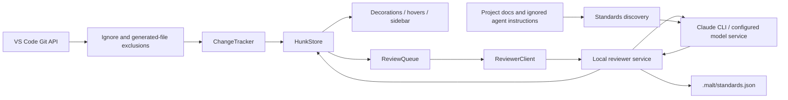

# Architecture

MALT has two runtimes: the VS Code extension and a local HTTP reviewer service. They share validated protocol types, not VS Code objects.

## Code map

| Directory | Responsibility |
| --- | --- |
| `src/git`, `src/diff` | Narrow built-in Git API contract and unified-diff parsing |
| `src/review` | Change tracking, content-keyed review state, bounded queue and HTTP client |
| `src/editor`, `src/views` | Theme-aware outlines, escaped hover Markdown and native tree/status-bar views |
| `src/backend` | Reviewer lifecycle, Docker API, host process and credential storage |
| `src/standards` | Scan command and generated-output writing |
| `src/reviewer` | HTTP service, confined file reads, standards discovery, trust rules and provider calls |
| `src/shared` | Wire protocol and runtime validation |
| `src/test/suite` | Extension-host tests with a dependency-free harness |

## Data flow and invariants

Git events debounce for 600 ms. The tracker filters deleted/ignored statuses and `.malt/` paths, then asks Git to resolve ignore rules. It computes working-tree differences against HEAD, with status, file metadata and HEAD commit in the diff-cache key. New text files are bounded at 512,000 bytes and checked for NUL bytes. Removed files are pruned from the store and diff cache.

New blocks trigger optional review and file opening. The review queue limits concurrency and deduplicates waiting/in-flight block IDs. Completed reviews persist in VS Code workspace state, bounded to 2,000 cached states. The UI subscribes to store changes. Automatic navigation uses preview tabs and preserves focus.

Review IDs identify content and deliberately ignore line numbers. Identical blocks can share a cached verdict, but each sidebar row includes its URI and line range in its identity. Navigation carries the content ID and start line and resolves them against the current store; stale or invalid locations do not fall back to a different occurrence. Line shifts preserve cached reviews while updating row locations.

Standards discovery is independent of Git change filtering. It can read ignored project instructions, but skips generated `.malt/` directories. The save operation creates an internal `.gitignore` only when absent. The reviewer reads the resulting rules file explicitly and sanitizes rules before combining them with immutable baseline checks. The scan also writes `.malt/architecture.json`; the reviewer re-sanitizes it on load and sends each call only a related slice (`src/reviewer/architecture.ts`).

The service validates request/response shapes and confines workspace reads. Claude calls are tool-less, use an isolated working directory, and disable project/user settings and MCP configuration loading. Model results and repository text are untrusted; hover text is escaped and only the MALT retry command is enabled. See [SECURITY.md](../SECURITY.md) for the security and dependency policy.

## Making changes

Keep reviewer/shared code independent of VS Code. Use the built-in Git API rather than launching Git from extension code. Preserve separate standards-discovery and micro-review exclusions. Extend the regression suite for changes to trust boundaries, queue state, cache invalidation, or filtering. Run `npm run verify` and the relevant [editor acceptance checks](editor-testing.md); build `npm run vsix` to verify packaging.
